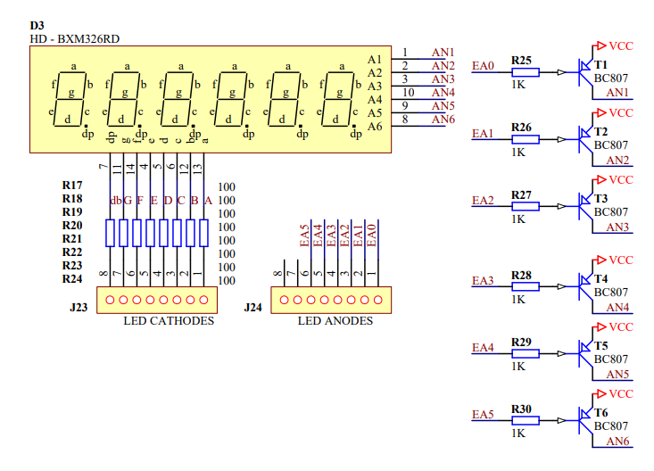
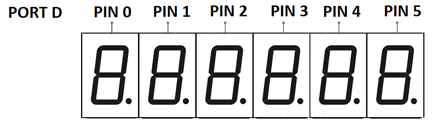

# Multiplex sedmisegmentového displeje
Na našem přípravku máme celkem 6 pozic sedmisegmentového displeje. Řídit jednu pozici displeje už umíme, nyní bychom chtěli pokročit a zobrazovat víceciferná čísla. Ze schématu ale víme, že sada vodičů pro řízení jednotlivých segmentů je jen jedna. Jak to tedy udělat, abychom mohli na různých pozicích zobrazovat různá čísla?

Schéma zapojení displeje v našem přípravku:

Zápisem na Port D volíme, které pozice displeje mají být aktivní. Nula danou pozici rozsvítí, jednička zhasne.

## Časový multiplex
Budeme muset použít techniku, které se říká časový multiplex. Multiplexování je způsob, jak sdílet jeden komunikační kanál mezi více zdroji informací. V našem případě máme na přípravku 6 pozic sedmisegmentového displeje, ale pouze jednu sadu vodičů, které ovládají segmenty. Můžeme ale v čase postupně rozsvěcet a zhasínat jednotlivé pozice displeje. Pokud to budeme dělat dostatečně rychle, díky setrvačnosti lidského oka se nám bude zdát, že všechny pozice displeje svítí zároveň. 

*Zdroj obrázku: By Laserlicht, CC BY-SA 4.0, https://commons.wikimedia.org/w/index.php?curid=115556518* 

## Úkoly:

**1.** Napište program, který zobrazí trojciferné číslo. 
Doporučený postup:

- Nastavte vstupy/výstupy pro 7seg displej
- Vytvořte pole s kombinacemi segmentů pro jednotlivé číslice  
- Vytvořte pole s nastavením anod, pro aktivaci jednotlivých číslic
- Vytvořte pole s číslem, které chceme zobrazit
- Napište cyklus, který vždy zapíše číslici na danou pozici a  1ms počká

**2.** Rozšiřte program tak, aby zobrazoval šesticiferné číslo.

**3.** Vytvořte funkci **void zobraz_cislo(int cislo)**, která dostane jako vstup 1-6 ciferné číslo. Funkce toto vstupní číslo rozloží na jednotlivé číslice a zobrazí je na displeji.

## Další zajímavé zdroje informací

[Video](https://www.youtube.com/shorts/Llq0WlhyLzQ)

### [Zpět na obsah](README.md)
