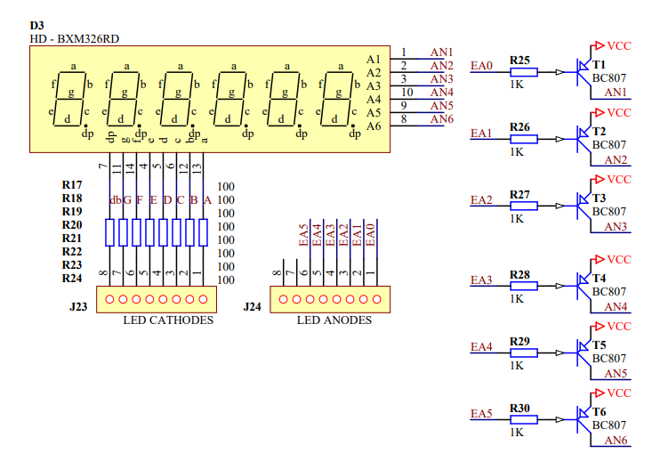
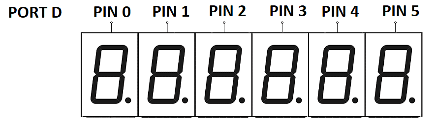

# Multiplex sedmisegmentového displeje
Na našem přípravku máme celkem 6 pozic sedmisegmentového displeje. Řídit jednu pozici displeje už umíme, nyní bychom chtěli pokročit a zobrazovat víceciferná čísla. Ze schématu ale víme, že sada vodičů pro řízení jednotlivých segmentů je jen jedna. Jak to tedy udělat, abychom mohli na různých pozicích zobrazovat různá čísla?

Schéma zapojení displeje v našem přípravku:


Zápisem na Port D volíme, které pozice displeje mají být aktivní. Nula danou pozici rozsvítí, jednička zhasne.




## Časový multiplex
Budeme muset použít techniku, které se říká časový multiplex. Multiplexování je způsob, jak sdílet jeden komunikační kanál mezi více zdroji informací. V našem případě máme na přípravku 6 pozic sedmisegmentového displeje, ale pouze jednu sadu vodičů, které ovládají segmenty. Můžeme ale v čase postupně rozsvěcet a zhasínat jednotlivé pozice displeje. Pokud to budeme dělat dostatečně rychle, díky setrvačnosti lidského oka se nám bude zdát, že všechny pozice displeje svítí zároveň. 


*Zdroj obrázku: By Laserlicht, CC BY-SA 4.0, https://commons.wikimedia.org/w/index.php?curid=115556518* 


## Vliv frekvence multiplexingu na vnímání lidským okem
Zkuste si do přípravku nahrát program níže.Je to jednoduchá ukázka časového multiplexu displeje. Potenciometrem na přípravku můžete nastavit dobu, po kterou je rozsvícena jedna pozice. Měli byste vidět, že od určité rychlosti už lidské oko přestane vidět blikání, ale zdá se mu, že všechny pozice svítí stabilně.

```c
#include <avr/io.h>
#define F_CPU 16000000
#include <util/delay.h>

unsigned char cisla[]={0xc0,0xf9,0xA4,0xb0,0x99,0x92,0x82,0xd8,0x80,0x90,0x88,0x83,0xc6,0xA1,0x86,0x8e};
	
int main(void)
{
	DDRB = 0xff; // Nastaví port B, jako výstup (je připojen k segmentům displeje)
	DDRD = 0xff; // Nastaví port D, jako výstup (je připojen k anodám, řídí, která číslice je aktivní)

	// Nastavení AD převodníku, abychom mohli potenciometrem nastavovat rychlost displeje
	ADMUX = 0x40;
	ADCSRA = (1 << ADEN) | (1 << ADPS2) | (1 << ADPS1) | (1 << ADPS0);
	ADCSRB = 0x08;

	// Nekonečná smyčka	
	while(1)
	{
		// Zahájí ADC konverzi
		ADCSRA |= (1 << ADSC);
		// Počká na dokončení konverze
		while (ADCSRA & (1 << ADSC));
		// Výsledek AD převodu je číslo 0-1024, my chceme nastavovat delay displeje cca od 1ms do 50ms, takže dělíme 20
		int wait_ms = ADC/20;

		for (int i=5; i>=0; i--) //
		{
			PORTD = ~(1<<i); // Zápisem do portu D vybereme i-tou pozici displeje
			PORTB = cisla[i];	// Zapíše na displej i-tý prvek z pole

			for (int i = 0; i <= wait_ms; i++) {
				_delay_ms(1);  // Zavolá zpoždění 1 ms `wait_ms` krát
			}
		}
	}
}
```

## Úkoly:
Pozn. Neupravujte příklad výše, ale založte si nový projekt a jen si zkopírujte pole s nastavením segmentů.

**1.** Napište program, který zobrazí trojciferné číslo

- Nastavit vstupy/výstupy pro 7seg displej
- Vytvořit pole s kombinacemi segmentů pro jednotlivé číslice  
- Vytvořit pole s nastavením anod, pro aktivaci jednotlivých číslic
- Vytvořit pole s číslem, které chceme zobrazit
- Napsat cyklus, který vždy zapíše číslici na danou pozici a  1ms počká

**2.** Rozšiřte program tak, aby zobrazoval šesticiferné číslo.

**3.** Vytvořte funkci **void zobraz_cislo(int cislo)**, která dostane jako vstup 1-6 ciferné číslo. Funkce toto vstupní číslo rozloží na jednotlivé číslice a zobrazí je na displeji.


## Další zajímavé zdroje informací

[Video](https://www.youtube.com/shorts/Llq0WlhyLzQ)

### [Zpět na obsah](README.md)
